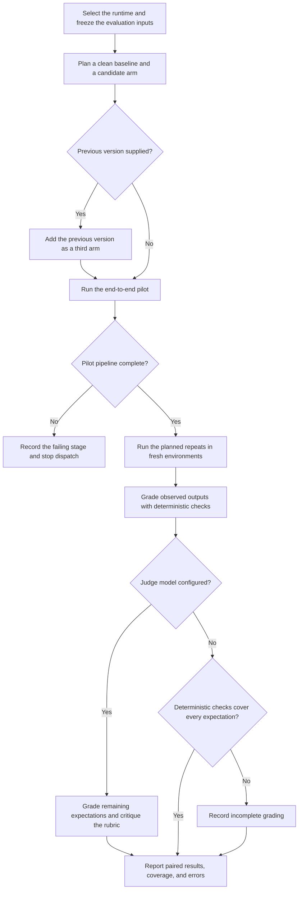
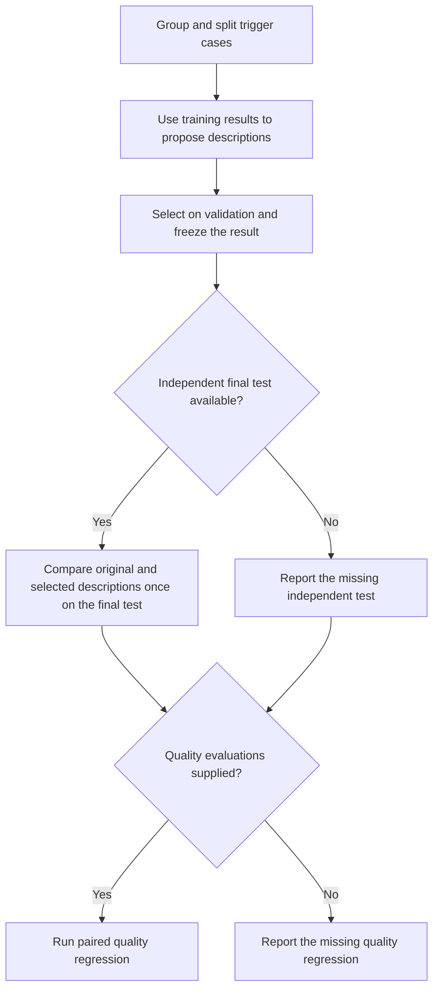
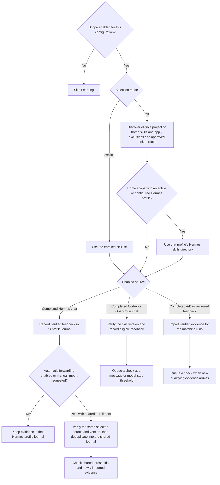
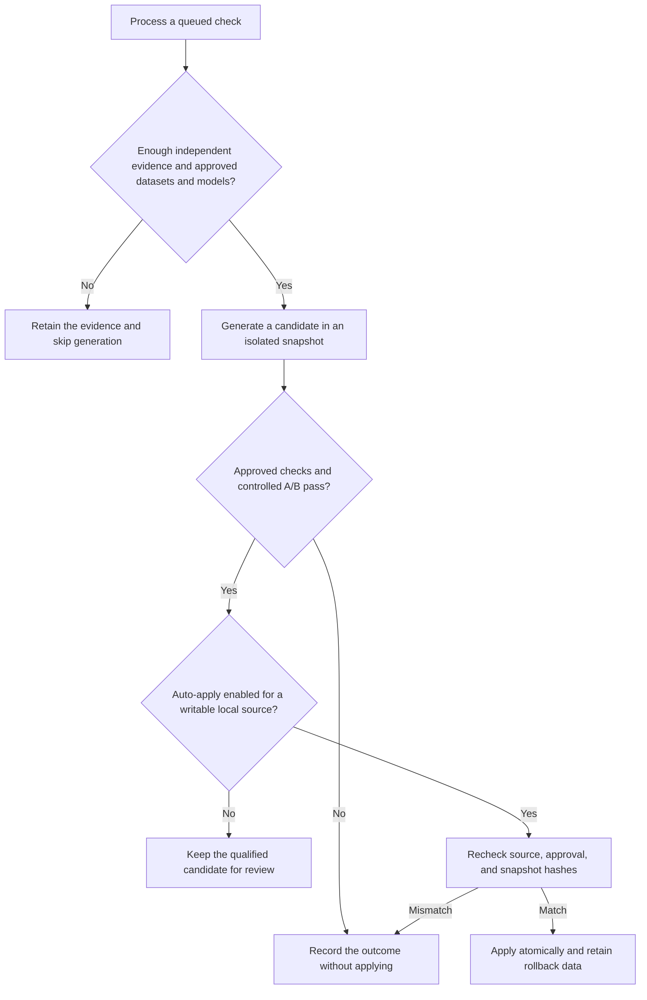

# SkillCraft workflows

See the [configuration reference](configuration.md) for flags, defaults, and
supported combinations.

## Quality A/B

`run_quality_eval.py` creates a new workspace and freezes the inputs, rubric,
settings, and skill snapshots before running any arms.

Codex and OpenCode can use an independent judge. Hermes file A/B requires
macOS and deterministic grading. A completed negative quality result can pass
the pilot pipeline. A missing artifact or technical failure is reported
separately from a scored task outcome.

## Description optimization

Codex and OpenCode support the trigger-based `run_loop.py` workflow. Hermes can
propose descriptions from supplied training results with
`improve_description.py`. It has no trigger-evaluation runner.

## Learning

Use [project or home scope](learning.md) to choose the journal. Linked sources
can contribute evidence and receive candidate reports. Their source files are
read-only to Learning promotion and rollback.

Unverified chat use stays diagnostic. Feedback on `without_skill` is attached
to the A/B run without rating the skill or triggering a revision by itself.
Learning's own A/B runs do not feed back into the journal.

Generation requires three independent observations or a correction backed by a
reproducible failure. The optimizer sees approved training evidence. The A/B
worker protects holdout and previously confirmed behavior across configured
runtimes. Executable changes also require owner-provided tests in the configured
offline validation environment.
