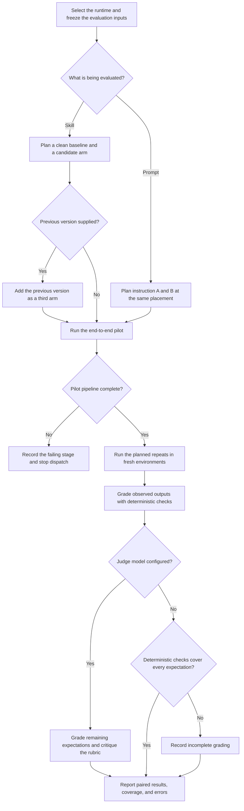
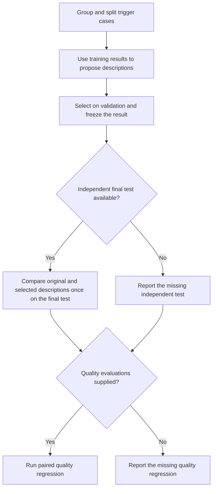
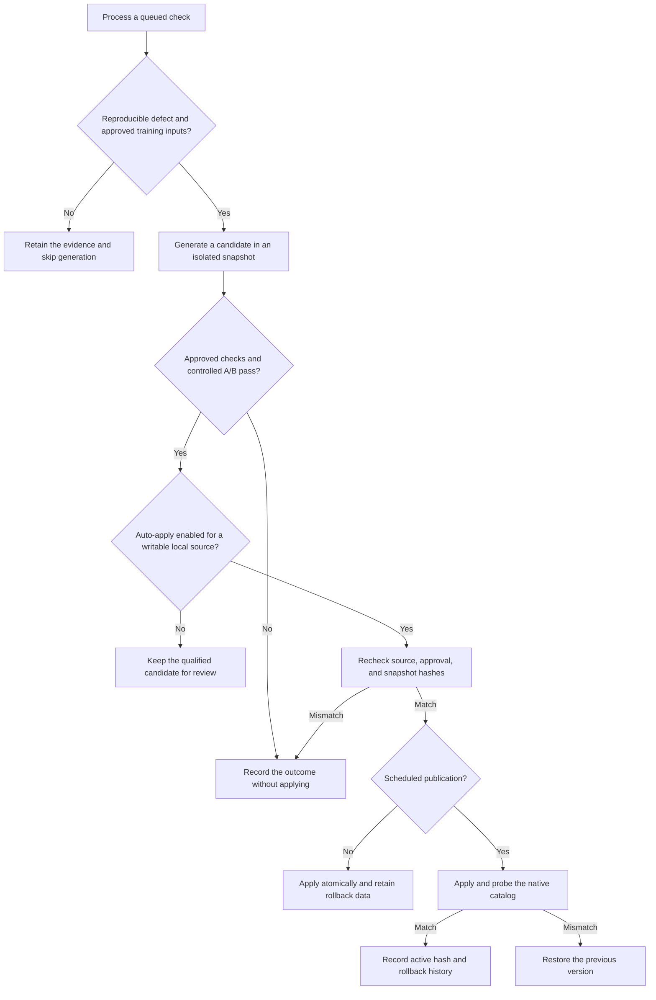

# SkillCraft workflows

See the [configuration reference](configuration.md) for flags, defaults, and
supported combinations.

## Quality A/B

`run_quality_eval.py` creates a new workspace and freezes the inputs, rubric,
settings, and skill or instruction snapshots before running any arms.

Codex and OpenCode can use an independent judge. Hermes file A/B requires
macOS and deterministic grading. A completed negative quality result can pass
the pilot pipeline. A missing artifact or technical failure is reported
separately from a scored task outcome.
See [prompt A/B](prompt-ab-evaluation.md) for instruction placement and
incomplete-pair accounting.

## Description optimization

Codex, OpenCode, and Hermes support the trigger-based `run_loop.py` workflow.
Hermes uses its native skill catalog and isolated macOS profile.

## Learning

Use [project or home scope](learning.md) to choose the journal. Project
configuration takes precedence; home collection stops at project boundaries.
With `selection: explicit`, only enrolled skills are observed. With `selection:
all`, eligible skills are discovered on each call, but discovery alone grants no
model-work approval. Linked sources can contribute evidence and receive
candidate reports. Their source files are read-only to Learning promotion and
rollback.

```mermaid
flowchart TD
    A["Find the closest learning configuration"] --> PR{"Project configuration found?"}
    PR -->|Yes| PEN{"Enabled and enrolled?"}
    PEN -->|Yes| PJ["Use project journal and policy"]
    PEN -->|No| DISABLED["Skip Learning; disabled config blocks home fallback"]
    PR -->|No| HB{"Home fallback applies before a project boundary?"}
    HB -->|Yes| HJ["Use home journal and policy"]
    HB -->|No| B["Skip Learning"]
    PJ --> SEL{"Selection mode"}
    HJ --> SEL
    SEL -->|explicit| D["Use the enrolled skill list"]
    SEL -->|all| E["Discover eligible skills; apply exclusions and approved linked roots"]
    D --> P
    E --> P{"Home scope with an active or configured Hermes profile?"}
    P -->|Yes| Q["Use that profile's Hermes skills directory"]
    P -->|No| F
    Q --> F
    F -->|Completed Codex or OpenCode chat| G["Record observations and bind verified feedback to the skill version"]
    F -->|Completed Hermes chat| H["Record observations and verified feedback in the profile journal"]
    F -->|Completed A/B or reviewed feedback| I["Import verified evidence for the matching runs"]
    H --> J{"Automatic forwarding enabled or manual import requested?"}
    J -->|No| K["Keep evidence in the Hermes profile journal"]
    J -->|Yes, with shared enrollment| L["Import feedback only when scope, source, skill version, and completed turn match"]
    J -->|Yes, both scopes use automation| U["Import completed observations; some may remain unbound"]
    U --> UQ{"Owner-approved deterministic case or proof?"}
    UQ -->|No| UD["Keep unbound observations for optional reflection"]
    UQ -->|Yes| OBS["Admit checked observation for creation"]
    G --> M["Queue a checkpoint every 15th observed message or completed model step"]
    I --> N["Queue a checkpoint when new qualifying evidence arrives"]
    L --> N["Queue a checkpoint when bound evidence is newly imported"]
    OBS --> N
    M --> AUTO{"Scheduled automation configured?"}
    N --> AUTO
    WORK["Explicit work command"] --> AUTO
    AUTO -->|No| REV["Ordinary revision worker; model calls need approved per-skill inputs and evidence"]
    AUTO -->|Yes| DUE{"Interval due or a batch is resuming?"}
    DUE -->|No| WAIT["Keep evidence; no scheduled batch model calls"]
    DUE -->|Yes| SCAN["Plan the due batch from currently eligible items"]
    SCAN --> ANY{"Any eligible batch items?"}
    ANY -->|No| EMPTY["Record an empty scan; no model calls"]
    ANY -->|Yes, session reflection| REFLECT["Extract a reusable lesson and check existing skill coverage"]
    REFLECT --> DRAFT["Stage a private text draft or report a review decision"]
    DRAFT -->|Approved independent cases| READY
    ANY -->|Yes, existing evaluation path| READY{"Training evidence, approved inputs, models, and approval ready?"}
    READY -->|No| WAIT
    READY -->|Yes| BATCH["Run the due batch"]
```

There is no background timer. In the normal hook flow, the completed assistant
turn checks the interval; explicit `work` checks it directly, and completed
evaluation or feedback imports can wake the worker. The batch checks the
persisted due time again before it starts.

Unverified chat use stays diagnostic. Feedback on `without_skill` is attached
to the A/B run without rating the skill or triggering a revision by itself.
Learning's own A/B runs do not feed back into the journal.

One reproducible defect can queue a revision. In `selection: all`, discovered
skills are observational for ordinary per-skill revisions until approved
datasets, fixtures, complete harness settings, and current approval are present.
Scheduled creation can use approved deterministic cases and save a draft before
an independent holdout exists. The optimizer sees approved training evidence
only. A/B validation withholds the independent holdout and protects
previously confirmed behavior across configured runtimes. Executable changes
also require owner-provided tests in the configured offline validation
environment. Scheduled auto-publication additionally requires `auto_apply:
true`, a writable local source, unchanged approval and hashes, and a successful
native catalog check; a failed check rolls back the change. The ordinary
per-skill revision worker promotes atomically with recovery data but does not
run this scheduled catalog probe.

### From a conversation or verified evidence to publication

```mermaid
flowchart LR
    A["Explicit work or hook wake"] --> DUE{"Interval due or batch resuming?"}
    DUE -->|No| WAIT["Keep collecting; no scheduled batch calls"]
    DUE -->|Yes| B["Scan scoped evidence and artifact checks"]
    B -->|Verified experience and approved inputs| GEN["Prepare a candidate using existing Learning"]
    B -->|Reflect enabled and eligible chat signals| REF["Extract a reusable lesson and check skill coverage"]
    B -->|No eligible work| EMPTY["Record empty scan with zero model calls"]
    REF -->|Suitable target or uncovered task| ST["Stage a private text draft"]
    REF -->|Ambiguous, read-only, or one-off| P["Record the review outcome in preview"]
    M["Explicit request in the current chat"] -->|Relevant turns, no waiting period| ST
    ST -->|Scheduled Learning candidate| H{"Approved independent cases available?"}
    GEN --> H
    H -->|No| W["Keep the draft and await checks"]
    W -->|Approve cases and resume| H
    H -->|Yes| E["Evaluate the saved candidate"]
    ST -->|Optional verify-now| AB["Run A/B and show the report"]
    ST -->|Explicit apply, A/B optional| MA["Publish by owner action"]
    AB -->|Explicit apply| MA
    E --> G{"Quality, applicable trigger checks, and auto-apply pass?"}
    G -->|No| RPT["Keep the candidate and report"]
    G -->|Yes| AC["Recheck approval and hashes, then publish and probe the native catalog"]
    AC -->|Exact version discovered| Q["Record active hash and rollback history"]
    AC -->|Native check fails| V["Restore previous version or remove the new skill"]
    Q --> RB["Rollback checks the active hash"]
    MA --> RB
```

Manual `apply` reports `applied_manual_unverified` when the owner publishes a
draft without a passing verification. Scheduled auto-apply requires a passing
evaluation and rechecks approval, hashes, and the native catalog. A revision
from the existing Learning worker may need to be staged with `--source` to get
an ID for manual verification or apply. Reflected drafts already have an ID.
